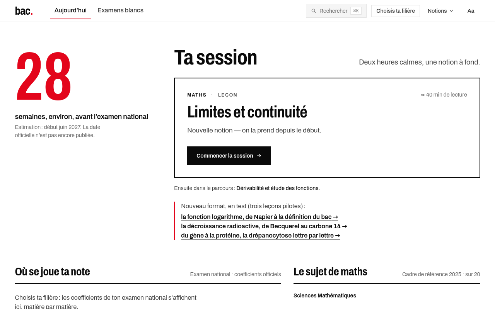
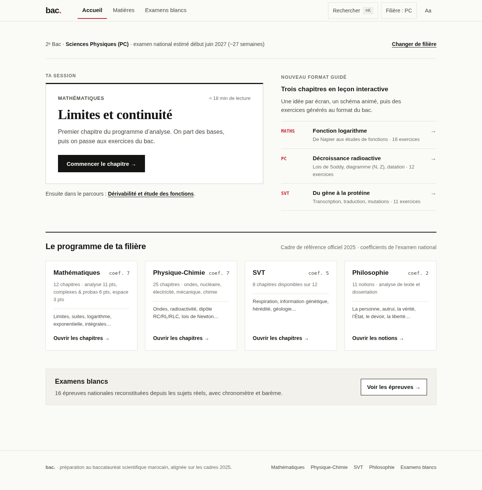
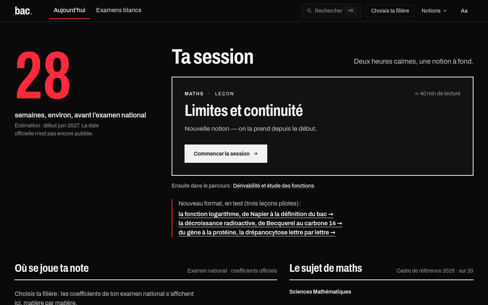
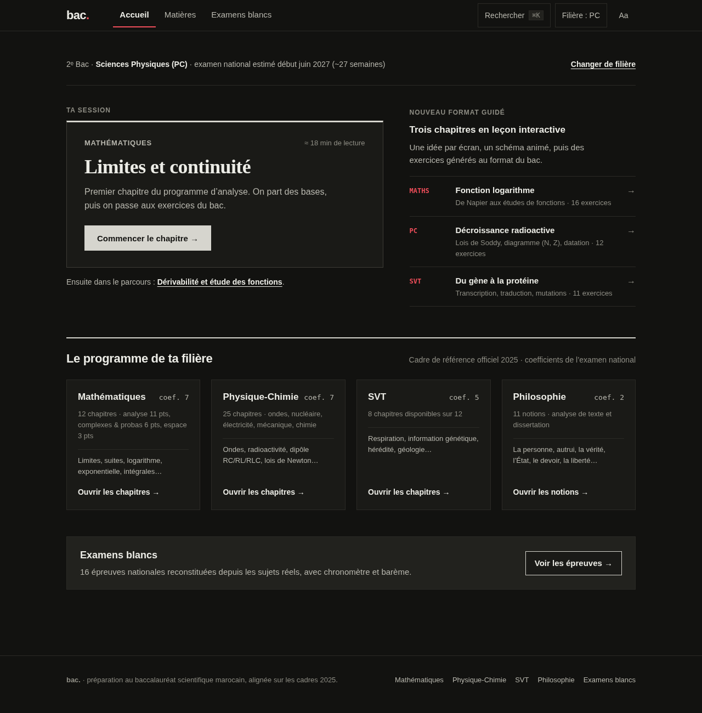
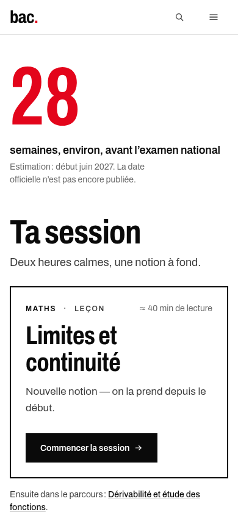
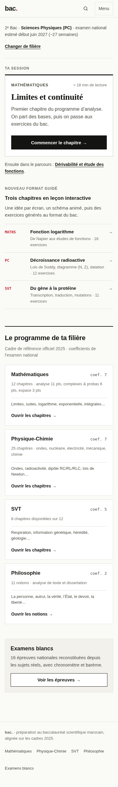
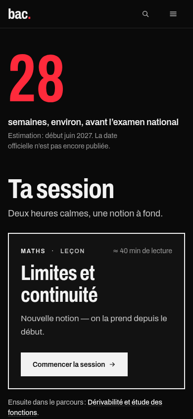
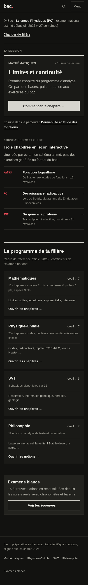

# Rapport 04 — Refonte UI/UX et suppression du « AI slop » (plan d'exécution)

> **Branche inspectée** : `claude/vibrant-fermi-v1lxj5` (`0baed308`).  
> **Méthode** : inspection du code source (`web/src/`), audit automatisé Chromium sur 13 routes à **1280 × 800** et **390 × 844** en thèmes **clair** et **sombre** (50 vues capturées, 0 débordement horizontal), et maquette codée de la direction proposée sur la page d'accueil.  
> **Rôle de ce document** (`MANDAT-UI.md` §4) : inventaire factuel du slop page par page, proposition de direction visuelle illustrée avant/après, et ordre des PR à enchaîner (`antigravity/ui-jetons` d'abord, puis une PR par surface).

## Synthèse (5 lignes)

Le site a une bonne ossature éditoriale (leçons pilotes, épreuves d'examens blancs, zéro débordement horizontal), mais l'empilement de quatre refontes successives laisse des scories partout : surfaces blanc pur (`#FFFFFF`) et noir dur (`#0A0A0A`), rouge néon surdimensionné (`11 rem`), 30+ fichiers portant des classes mortes (`rounded-xl`, `shadow-elevation-*`, `[--focus-radius:8px]` sur des boutons carrés), et plus de 60 cibles tactiles sous 44 px sur l'accueil mobile.  
Sur le plan du « AI slop » (`MANDAT-UI.md` §2), on relève des textes marketing ou internes visibles par l'élève (`omniscient, infiniment disponible`, `en test (trois leçons pilotes)`), des impasses (`/matieres/si` vide liée dans le pied de page global, `/connexion` sans lien de sortie et bouton Google « bientôt » désactivé), des doublons d'information et une colonne « Ta maîtrise » vide à tirets.  
Sur téléphone (390 px), l'accueil atteint **5 791 px** de haut et place un gigantesque `28` rouge avant la session du jour, reléguant les trois leçons interactives sous la ligne de flottaison.  
La direction proposée (« **Manuel calme** ») unifie le site autour d'un papier chaud (`#FAFAF7`) et d'un charbon chaud (`#121210`) passant les 76 paires de `contrast-gate.mjs`, d'une hiérarchie typographique nette et d'une seule action principale par écran.  
L'exécution démarre par une PR dédiée aux jetons (`antigravity/ui-jetons`), suivie de huit petites PR par surface avec captures avant/après.

## Les 5 changements qui auraient le plus d'effet

1. **Jetons papier chaud / charbon chaud et nettoyage des classes mortes (`antigravity/ui-jetons`)** : supprimer l'éblouissement `#FFFFFF` / `#0A0A0A` (que Claude a déjà dû contourner localement dans `.dark .pilote` et `.dark .exos`), adoucir le rouge signal (`#C81E2B` / `#F04E5A`), supprimer les 30+ `rounded-xl`/`shadow-elevation-*`/`[--focus-radius:*]` incohérents et la classe morte `.header-glass`.
2. **Alléger l'accueil et traiter le téléphone comme écran principal (`antigravity/ui-accueil`)** : remplacer le `28` rouge de 176 px par une ligne sobre dans le bandeau de contexte, remonter la session du jour et les 3 leçons interactives dès le premier écran mobile, supprimer la colonne « Ta maîtrise » vide (`—`), et remplacer le mur de 62 liens bruts (5 791 px sur mobile) par 4 cartes de matières propres avec coefficients et accès rapide (tout en respectant le contrat `dom-truth.mjs`, cf. §2.5).
3. **Supprimer toutes les impasses et boutons morts (`antigravity/ui-entete`, `ui-commencer-connexion`, `ui-matieres`)** : retirer `/matieres/si` du pied de page tant qu'aucun chapitre n'existe (comme `SiteHeader.tsx:178` le fait déjà), supprimer le bouton désactivé « Continuer avec Google — bientôt » dans `FormulaireConnexion.tsx:325-342` (et sa promesse ligne 221), ajouter une sortie claire sur `/connexion` fermé, et purger la description marketing dans `layout.tsx:88`.
4. **Garantir ≥ 44 px sur toutes les cibles tactiles (`ui-entete`, `ui-accueil`, `ui-pilotes-coquille`)** : corriger `ThemeToggle` (`32 × 32 px`), `FiliereBadge` (`31 px`), `Notions` (`29 px`), les liens de pied de page (`29 px`), les 3 liens pilotes de l'accueil (`17 px`), les pastilles d'exercices (`34 × 34 px`), les boutons `Vérifier` / `Un indice` (`34 px`) et les segments `.beat` des pilotes sur mobile (`11 px` de haut).
5. **Unifier les pages secondaires et supprimer les doublons (`ui-commencer-connexion`, `ui-matieres`, `ui-notions`, `ui-erreurs`)** : montrer les coefficients réels sur `/commencer` (sans mots coupés comme `Sciences Mathématiques / A`), supprimer la double mention `14 chapitres` / `30 min de lecture` et la contradiction `6 chapitres` vs `Chapitre 1 / 7` sur les notions, et aligner `not-found.tsx` / `error.tsx` / `global-error.tsx` sur la grille éditoriale à gauche.

---

## 1. Inventaire du « AI slop » et des défauts UI page par page

> Le critère (`MANDAT-UI.md` §2) : **qu'est-ce que l'élève en fait ?** S'il n'en fait rien, ça part.

| Surface | `fichier:ligne` | Ce qu'on observe (capture / mesure) | Remplacement concret |
|---|---|---|---|
| **Métadonnées & pied de page** | `web/src/app/layout.tsx:88` `web/src/components/ui/SiteFooter.tsx:32,41-57,61` | Triplet d'adjectifs + superlatif + tiret cadratin : *« Un tuteur patient, omniscient, infiniment disponible — préparation bac sciences au Maroc. »* ; pied de page avec deux tirets cadratins et lien vers `/matieres/si` (page vide) ; liens footer à `29 px` de haut. | Métadescription sobre et factuelle (*« Cours, schémas interactifs, exercices corrigés et annales du baccalauréat scientifique marocain, alignés sur les cadres de référence 2025. »*). Retirer `/matieres/si` du pied de page tant qu'elle est vide, retirer les tirets cadratins, passer les liens footer à `min-h-touch`. |
| **Jetons & thème global** | `web/src/lib/tokens.ts:54-64,87,101-119,159-166,343-352` `web/src/app/globals.css:410-420` | Les 4 surfaces claires sont toutes `#FFFFFF` (aucune profondeur tonale, éblouissement) ; dark `#0A0A0A` trop dur (contourné localement dans `pilote.css:217` et `exercices.css:100`) ; rouge `#E3051B`/`#FF2A3B` criard ; 5 `--subject-*` identiques (`#0A0A0A`/`#F2F2F2`) malgré des commentaires OKLCH obsolètes ; `.header-glass` (verre dépoli) mort ; ~30 fichiers gardent `rounded-xl`/`shadow-elevation-*`/`[--focus-radius:8px]` qui créent des halos de focus arrondis autour de boutons carrés. | Palette papier chaud `#FAFAF7`/`#FFFFFF`/`#ECECE6` et charbon chaud `#121210`/`#1A1A17`/`#262622`, rouge signal calibré `#C81E2B`/`#F04E5A`, commentaires synchronisés, suppression de `.header-glass` et des classes mortes `rounded-*`/`shadow-elevation-*`/`[--focus-radius:*]`. |
| **En-tête & navigation** | `web/src/components/ui/SiteHeader.tsx:75,92,195,382` `ThemeToggle.tsx:65` `FiliereBadge.tsx:39-41` | Carré noir/blanc `10 × 10 px` (`--subject-${id}`) identique pour les 4 matières dans `PanneauNotions` et `MenuCompact` (purement décoratif). Cibles sous 44 px mesurées : `bac.` (`38 px`), `Rechercher` (`36 px`), `Choisis ta filière` (`31 px`), `Notions` (`29 px`), `ThemeToggle` (`32 × 32 px`), `[--focus-radius:9999px]` sur bouton carré. | Supprimer les carrés décoratifs identiques ; passer tous les contrôles d'en-tête et du menu mobile à `min-h-touch` (44 px) ; unifier les libellés (`Accueil`, `Matières`, `Examens blancs`) et regrouper sobrement `Rechercher`, `Filière` et `Aa` (qui contient déjà le thème). |
| **Accueil (`/`)** | `web/src/app/page.tsx:60,68-87` `ExamCountdown.tsx:32` `SessionCard.tsx` `NoteEnJeu.tsx:92,101,119-121` `SujetMaths.tsx:54` `ProgrammeMap.tsx:112-133` | Captures `avant-accueil-{1280,390}-{light,dark}.png`. `28` rouge géant (`11 rem` = 176 px) qui écrase `SessionCard` (et mange 35 % de l'écran téléphone) ; contradiction *« Deux heures calmes »* vs `≈ 40 min de lecture` ; tiret cadratin dans `SessionCard` (*« Nouvelle notion — on la prend depuis le début. »*) ; cadrage interne *« en test (trois leçons pilotes) »* avec liens de `17 px` de haut ; colonne « Ta maîtrise » entièrement remplie de `—` ; double graphique SM + SExp empilé sans filière ; mur de 62 liens (`37 px` de haut) portant la page mobile à **5 791 px** et **67 cibles < 40 px**. | Voir maquette `apres-accueil-*` ci-dessous : bandeau filière + date estimée sur 1 ligne, 1re rangée = `SessionCard` (action principale unique) + bloc propre des 3 leçons interactives (cibles ≥ 44 px, sans jargon interne), 2e rangée = 4 cartes de matières avec coefficients intégrés et couverture honnête, 3e rangée = bandeau Examens blancs. Suppression de la colonne vide « Ta maîtrise » et du slogan contradictoire. |
| **Choisir sa filière (`/commencer`)** | `web/src/app/commencer/page.tsx:20,32-34` `FiliereChooser.tsx` | Capture `avant-commencer-1280-light.png`. Titres coupés en orphelins (`Sciences Mathématiques` / `A`, `Sciences de la Vie et de la` / `Terre`) à cause du badge gris à droite ; promesse *« tes coefficients s'adaptent »* mais **aucun coefficient n'est affiché** (remplacé par des phrases vagues comme *« une physique exigeante »*) ; SM-B liste `Sciences de l'ingénieur` sans dire que le contenu n'est pas encore en ligne. | Cartes éditoriales lisibles sans coupure orpheline, affichant les vrais coefficients du cadre (`Maths 9 · PC 7 · SVT 3 · Philo 2`, etc.), mention honnête `(à venir)` pour SI en SM-B, suppression du badge gris superflu. |
| **Connexion (`/connexion`)** | `web/src/app/connexion/page.tsx` `FormulaireConnexion.tsx:221,325-342` | Capture `avant-connexion-1280-light.png`. Quand l'auth est fermée (état actuel) : une phrase sèche sans aucun bouton de retour (impasse). Quand l'auth est active : promesse ligne 221 *« avec Google en accès rapide »* suivie d'un bouton désactivé « Continuer avec Google » + pastille « bientôt » (bouton sans effet, interdit par `MANDAT-UI.md` §2). | En mode fermé : ajouter un lien d'action clair (*« Retour à l'accueil »* / *« Parcourir les chapitres sans compte »*). Dans `FormulaireConnexion.tsx` : supprimer complètement le bouton Google mort, son `GoogleGlyph` et la mention ligne 221 tant qu'OAuth n'est pas branché. |
| **Matières (`/matieres/[subject]`)** | `web/src/app/matieres/[subject]/page.tsx:80` `ChapterList.tsx:115,131-149` | Captures `avant-matiere-maths-1280-light.png` et `avant-matiere-si-1280-light.png`. `14 chapitres` affiché deux fois dans l'en-tête (`2e Bac · Sciences · 14 chapitres` en `GeistMono` + gros `14 chapitres` à droite) ; aucun repère indiquant que Logarithme / Radioactivité / Expression génétique disposent d'une leçon interactive guidée + exercices générés ; `/matieres/si` affiche une boîte pointillée centrée avec icône décorative `empty-doc` (*« Programme à venir »*) et un warning ESLint `aria-disabled` sur `<li>`. | Supprimer le doublon `14 chapitres` (garder le seul bloc chiffré propre et le contrat `header [data-couverture]` en `GeistMono`) ; ajouter un lien discret vers le format interactif + exercices sur les 3 chapitres qui l'ont ; remplacer la boîte centrée `empty-doc` de `/matieres/si` par un texte éditorial sobre aligné à gauche avec lien de retour vers Maths / PC (et retirer le lien SI du pied de page). |
| **Notions ancien format (`/notions/[subject]/[slug]`)** | `web/src/components/notion/NotionPageView.tsx` `BankCard.tsx:94-108` `McqItem.tsx:98,105` `StagedFigure.tsx:497,501` `Derivation.tsx:92-93` | Capture `avant-notion-rc-1280-light.png`. Contradiction visuelle immédiate : l'en-tête annonce **`6 chapitres`** alors que le sommaire juste en dessous affiche **`Chapitre 1 / 7`** (car il inclut l'étape Exercices) ; `30 min de lecture` répété deux fois en 200 px ; 16 composants `notion/` portent encore `rounded-xl` + `shadow-elevation-1/2` + `badgePill` hérités de l'ancien thème. | Aligner le compteur d'en-tête et le sommaire (`6 parties + exercices` ou compteur unique cohérent), supprimer la répétition de `30 min de lecture`, nettoyer les classes mortes `rounded-xl`/`shadow-elevation-*` et les piles de pastilles dans `BankCard.tsx`. |
| **Examens blancs (`/examens`, `/examens/[id]`)** | `web/src/app/examens/page.tsx` `web/src/components/examens/EpreuveShell.tsx` | Capture `avant-examens-1280-light.png`. Bonne structure d'horaire sur bureau, mais **4 258 px** sur téléphone sans filtre par filière (un élève de SM doit défiler 29 épreuves PC/SExp avant de voir les siennes) ; badge `Partielle` en majuscules ; contraste dur `#FFFFFF`/`#0A0A0A`. | Ajouter un filtre simple par filière en haut de `/examens` (pré-positionné sur la filière choisie par l'élève, avec option *« Toutes »*), garder la liste horaire calme avec les nouveaux jetons papier/charbon. |
| **Erreurs & 404** | `web/src/app/not-found.tsx:28-38` `web/src/app/error.tsx:51` `web/src/app/global-error.tsx:17-20,60,69` | Capture `avant-not-found-1280-light.png`. Carte SaaS générique centrée (`rounded-xl shadow-elevation-1 text-center`) avec gros `404` gris décoratif qui jure avec la mise en page à gauche du site ; `global-error.tsx` utilise des hexagones d'une ancienne palette (`#f7f7f4`, `#1d1a14`) et `borderRadius: 0.5rem`. | Mise en page éditoriale alignée à gauche (comme le reste du manuel), sans gros `404` décoratif ni carte centrée, avec accès direct à l'accueil et aux matières ; aligner `global-error.tsx` sur les nouveaux jetons papier/charbon et `borderRadius: 0`. |
| **Coquille pilotes & exercices** | `web/src/components/pilote/PiloteCoquille.tsx` `web/src/app/pilote/logarithme/pilote.css:40,63,217-225,251-262` `web/src/app/pilote/exercices.css:14,23,83,100-104` | Capture `avant-pilote-ln-390-light.png`. Sur téléphone (390 px), la barre du pilote + l'en-tête du site consomment **212 px** avant la scène ; les segments `.beat` mesurent **`11 px` de haut** (`10 × 11 px` à `45 × 11 px`) ; `.rejouer` fait `~30 px` ; dans les exercices, les pastilles `.exos-pastille` font **`34 × 34 px`** et les boutons `Vérifier` / `Un indice` font **`34 px`** de haut. Les deux CSS contiennent des rustines `.dark` en `color-mix` pour compenser la dureté du thème sombre global. | Sans toucher au moteur (`noyau.js`, `*-moteur.js`, `*-scenes-*.js`) : compacter la barre mobile du pilote, garantir ≥ 44 px sur `.exos-pastille`, `.exos-btn.petit`, `.exos-lecon` et `.rejouer` (et zone tactile étendue sur `.beat` mobile), et simplifier les rustines `.dark` une fois les jetons globaux adoucis. |

---

## 2. Direction proposée : « Manuel calme »

### 2.1 Principes directeurs

1. **Papier, pas écran néon** : un fond clair très légèrement teinté (`#FAFAF7`) qui distingue les cartes (`#FFFFFF`) et les bandeaux (`#ECECE6`) sans ombres ni dégradés ; un thème sombre charbon chaud (`#121210` / `#1A1A17`) qui élimine le halo blanc sur noir pur.
2. **Un seul accent de signal, dosé au millimètre** : l'action primaire reste en encre (`#181816` / `#EDECE6`) pour le calme ; le rouge signal assourdi (`#C81E2B` clair / `#F04E5A` sombre) ne marque que le repère actif (onglet courant, étiquette de matière dans les pilotes, erreur, point focal d'un schéma). Plus de chiffre de 176 px en rouge vif.
3. **Géométrie franche et cohérente** : angles à `0 px` assumés partout (cohérent avec les pilotes), séparation par filets fins (`1 px` et `2 px`), **zéro ombre**, **zéro verre dépoli**, **zéro halo de focus arrondi** sur des boutons carrés.
4. **Téléphone d'abord, bureau généreux** : dès le premier écran à 390 × 844, l'élève voit sa filière, sa session du jour et son bouton principal sans faire défiler un bloc décoratif. Toutes les cibles tactiles respectent **≥ 44 px**.

### 2.2 Palette proposée (vérifiée contre `scripts/contrast-gate.mjs`)

Toutes les paires vérifiées ci-dessous respectent les seuils exacts de `web/scripts/contrast-gate.mjs` (≥ 4,5:1 pour les textes, ≥ 3,0:1 pour `--color-border-field`) :

| Jeton | Actuel (clair → sombre) | Proposé (clair → sombre) | Contraste min. mesuré (seuil) |
|---|---|---|---|
| `--color-surface-base` | `#FFFFFF` → `#0A0A0A` | `#FAFAF7` → `#121210` | Toile papier chaud / charbon chaud |
| `--color-surface-raised` | `#FFFFFF` → `#121212` | `#FFFFFF` → `#1A1A17` | Carte distincte de la toile (clair + sombre) |
| `--color-surface-container-highest` | `#FFFFFF` → `#202020` | `#ECECE6` → `#262622` | Bandeaux secondaires / états actifs |
| `--color-text-primary` | `#0A0A0A` → `#F2F2F2` | `#181816` → `#EDECE6` | **14,99:1** clair / **12,83:1** sombre (≥ 4,5) |
| `--color-text-secondary` | `#525252` → `#B8B8B8` | `#4A4A44` → `#B3B2A8` | **7,52:1** clair / **7,12:1** sombre (≥ 4,5) |
| `--color-text-tertiary` | `#6E6E6E` → `#9E9E9E` | `#5C5C55` → `#939289` | **5,68:1** clair / **4,86:1** sombre (≥ 4,5) |
| `--color-signal` | `#E3051B` → `#FF2A3B` | `#C81E2B` → `#F04E5A` | **5,46:1** clair / **4,94:1** sombre (≥ 4,5) |
| `--color-border-field` | `#767676` → `#949494` | `#6B6B63` → `#8E8D83` | **5,14:1** clair / **5,22:1** sombre (≥ 3,0) |
| `--color-border-subtle` | `#E5E5E5` → `#262626` | `#E4E4DC` → `#2B2B26` | Filets structurants chauds |
| `--color-success` / `warning` / `error` | `#146C43` / `#8A4B08` / `#B91C1C` (clair) | Conservés en clair ; `#4ADE80` / `#FBBF24` / `#F87171` (sombre) | **≥ 6,31:1** sur `base` et `raised` (≥ 4,5) |

### 2.3 Exemple refait : page d'accueil (avant / après, 1280 et 390 px, clair et sombre)

#### Bureau — 1280 × 800, thème clair

| Avant (`0baed308`) | Après (direction proposée) |
|---|---|
|  |  |

#### Bureau — 1280 × 800, thème sombre

| Avant (`0baed308`) | Après (direction proposée) |
|---|---|
|  |  |

#### Téléphone — 390 × 844, thème clair

| Avant (`0baed308`) | Après (direction proposée) |
|---|---|
|  |  |

#### Téléphone — 390 × 844, thème sombre

| Avant (`0baed308`) | Après (direction proposée) |
|---|---|
|  |  |

> **Ce qui change concrètement sur cet écran** :
> - Le compte à rebours passe d'un `28` rouge de 176 px à une information factuelle d'une ligne avec la filière et le lien `Changer de filière`.
> - Une seule action primaire (`Commencer le chapitre →`) domine la première vue, aussi bien sur bureau que sur téléphone.
> - Les trois leçons interactives sont présentées comme de vrais chapitres du manuel (titre, thème, nombre d'exercices), sans mention interne « en test / pilotes », avec des lignes cliquables ≥ 44 px.
> - Les coefficients officiels et la couverture réelle du programme fusionnent dans les 4 cartes de matières (plus de colonne vide « Ta maîtrise » ni de double graphique empilé).

### 2.4 Contestation de `DESIGN-BIBLE.md` §1 (point d'arbitrage propriétaire)

`docs/product/DESIGN-BIBLE.md` §1 (lignes 92–115) pose : *« Desktop-web-primary. The design is built desktop-first and adapts down to smaller screens, not the reverse. Mobile is supported and real, but it is the secondary shape. »*  
`docs/revue-externe/MANDAT-UI.md` §3 (ligne 61) demande explicitement l'inverse : *« un téléphone traité comme l'écran principal (beaucoup d'élèves n'ont que lui) »*.

Les captures à 390 × 844 (`avant-accueil-390-light.png`, `avant-pilote-ln-390-light.png`, hauteur d'accueil de **5 791 px**, 67 cibles < 40 px) montrent le coût réel du *desktop-first* : sur téléphone, l'élève subit les choix conçus pour le grand écran (chiffre géant au-dessus de l'action, barre pilote à 3 étages, 62 liens empilés).  
**Proposition (constat `G-04-011`)** : amender `DESIGN-BIBLE.md` §1 pour adopter **téléphone comme écran principal** (action primaire visible sans défilement à 390 × 844, toutes cibles ≥ 44 px, hauteur maîtrisée), tout en conservant la colonne de lecture bornée (65 caractères) et les marges généreuses sur bureau.

### 2.5 Contrats DOM à préserver (et point à valider avec Claude avant `ui-accueil`)

Les portes CI (`web/scripts/dom-truth.mjs`, `token-gate.mjs`, `contrast-gate.mjs`, `etroit-sweep.mjs`) vérifient plusieurs contrats stricts qui seront tous respectés :
- `token-gate.mjs` (zéro couleur en dur) et `contrast-gate.mjs` (76 paires clair/sombre).
- Sur `/` : un seul `[data-primary-action]`, `[data-reco-source='parcours']`, `[data-programme-matiere='pc'] header a` en `Archivo` `h4`, `[data-programme-matiere] [data-couverture]` (`M/N`), vocabulaire honnête (`D12 §5` : ni `%`, ni `maîtrisé`, ni `points`).
- **Point à trancher avant `antigravity/ui-accueil`** : `dom-truth.mjs:376,1300` exige que les **62 liens `a[data-mastery-token][href^='/notions/']`** soient présents dans le DOM de `/`. Deux options propres pour éviter le mur de 5 791 px sur mobile :
  - **Option A (sans toucher `dom-truth.mjs`)** : dans chacune des 4 cartes de matières sur `/`, placer la liste numérotée des chapitres dans un `
` fermé par défaut (*« Voir les 12 chapitres »*) — les 62 liens restent dans le DOM et accessibles en un clic, mais la page mobile reste courte (~1 600 px).
  - **Option B (avec accord de Claude)** : alléger `dom-truth.mjs` pour que la liste complète des 62 chapitres vive sur `/matieres/[subject]` (déjà dédiée à cela) et non dupliquée sur `/`.

---

## 3. Ordre des PR prévu

Chaque PR réservera ses fichiers dans `docs/revue-externe/CHANTIERS.md`, passera `batterie-locale.mjs`, `npm run build` (et `pilotes-parcours.mjs --porte` pour la coquille pilotes), et inclura les captures avant/après à 1280 × 800 et 390 × 844 (clair et sombre) + la liste avant/après des textes modifiés.

| Ordre | Branche PR | Périmètre | Dépend de |
|---|---|---|---|
| **1** | `antigravity/ui-jetons` | `web/src/lib/tokens.ts` → `tokens.generated.css`, `globals.css` (palette papier chaud / charbon chaud, rouge signal calibré, suppression `.header-glass`, synchronisation des commentaires). **Seule d'abord**, relue par Claude avant le reste (`MANDAT-UI.md` §4). | Validation de `04-ui-ux.md` |
| **2** | `antigravity/ui-entete` | `layout.tsx` (métadescription), `SiteHeader.tsx`, `SiteFooter.tsx`, `ThemeToggle.tsx`, `FiliereBadge.tsx`, `FontSizeStepper.tsx`, `Breadcrumb.tsx` (cibles ≥ 44 px, suppression carrés décoratifs, retrait du lien SI mort, nettoyage classes mortes `rounded-*`/`shadow-*`/`[--focus-radius:*]`). | PR 1 |
| **3** | `antigravity/ui-accueil` | `web/src/app/page.tsx`, `ExamCountdown.tsx`, `SessionCard.tsx`, `NoteEnJeu.tsx`, `SujetMaths.tsx`, `ProgrammeMap.tsx`, `NextUp.tsx` (refonte « Manuel calme » montrée en §2.3, suppression colonne « Ta maîtrise » vide et wording interne). | PR 1 + arbitrage Option A/B |
| **4** | `antigravity/ui-commencer-connexion` | `commencer/page.tsx`, `FiliereChooser.tsx`, `connexion/page.tsx`, `FormulaireConnexion.tsx` (coefficients visibles, suppression coupures orphelines, retrait du bouton Google « bientôt », lien de sortie sur `/connexion` fermé). | PR 1 |
| **5** | `antigravity/ui-matieres` | `matieres/[subject]/page.tsx`, `ChapterList.tsx` (suppression doublon `14 chapitres`, lien vers les 3 leçons interactives, refonte sobre de `/matieres/si` sans boîte pointillée `empty-doc`, correction warning `aria-disabled`). | PR 1 |
| **6** | `antigravity/ui-examens` | `examens/page.tsx`, `EpreuveShell.tsx` (filtre filière sur `/examens` pour éviter les 4 258 px sur mobile, cohérence des jetons et cibles ≥ 44 px). | PR 1 |
| **7** | `antigravity/ui-notions` | `NotionPageView.tsx`, `BankCard.tsx`, `McqItem.tsx`, `StagedFigure.tsx`, `Derivation.tsx`, `ChapterShell.tsx`, `LessonEnd.tsx`, `MarginRail.tsx` (correction `6 chapitres` vs `Chapitre 1 / 7`, suppression doublon `30 min de lecture`, purge des `rounded-xl`/`shadow-elevation-*`/`badgePill`). | PR 1 |
| **8** | `antigravity/ui-erreurs` | `not-found.tsx`, `error.tsx`, `global-error.tsx`, `VeilleHydratation.tsx`, `HydrationNotice.tsx` (alignement éditorial à gauche, suppression du `404` centré SaaS, synchronisation des teintes de secours). | PR 1 |
| **9** | `antigravity/ui-pilotes-coquille` | `PiloteCoquille.tsx`, `ExercicesPilote.tsx`, `pilote.css`, `exercices.css` (cibles ≥ 44 px sur `.beat`, `.rejouer`, `.exos-pastille`, `.exos-btn.petit`, allègement de la barre mobile, nettoyage des rustines `.dark`). **Sans toucher aux moteurs.** | PR 1 |

---

## 4. Constats structurés (`G-04-001` à `G-04-014`)

### Partie 1 — Faits vérifiables

#### G-04-001 — Métadescription marketing « AI slop » et tirets cadratins dans le pied de page
- **Gravité** : IMPORTANT
- **Où** : `web/src/app/layout.tsx:87-88`, `web/src/components/ui/SiteFooter.tsx:32,61`, `web/src/app/page.tsx:60`
- **Constat** : `SITE_DESCRIPTION` vaut `"Un tuteur patient, omniscient, infiniment disponible — préparation bac sciences au Maroc."` (triplet d'adjectifs, superlatif non prouvé, tiret cadratin). Le pied de page contient deux tirets cadratins (`sciences — préparer le bac marocain, calmement.` et `© 2026 — contenu aligné…`). Sur l'accueil, `page.tsx:60` affiche `Deux heures calmes, une notion à fond.` juste au-dessus d'une carte affichant `≈ 40 min de lecture` (`avant-accueil-1280-light.png`).
- **Preuve** : inspection source + capture `captures-04/avant-accueil-1280-light.png`.
- **Proposition** : remplacer par une description factuelle sans superlatif ni tiret cadratin, supprimer la phrase contradictoire de `page.tsx:60`, et réécrire le pied de page en une ligne simple (`bac. · préparation au baccalauréat scientifique marocain, alignée sur les cadres 2025.`).
- **Certitude** : certain
- **Effort** : petit

#### G-04-002 — Impasse globale : lien vers `/matieres/si` (page vide « Programme à venir ») dans le pied de page
- **Gravité** : BLOQUANT
- **Où** : `web/src/components/ui/SiteFooter.tsx:41-57`, `web/src/components/curriculum/ChapterList.tsx:131-149`
- **Constat** : Le pied de page présent sur toutes les pages du site comporte un lien direct `Sciences de l'ingénieur` vers `/matieres/si`, qui débouche sur une boîte pointillée centrée avec icône générique et le texte `Programme à venir — Les chapitres de cette matière seront ajoutés prochainement.` Or `SiteHeader.tsx:178-181` exclut déjà SI du panneau de navigation avec le commentaire : *« Une matière sans la moindre notion construite (SI aujourd'hui) n'a rien à offrir dans un panneau de NAVIGATION »*.
- **Preuve** : capture `captures-04/avant-matiere-si-1280-light.png` + `SiteHeader.tsx:178-181` vs `SiteFooter.tsx:41`.
- **Proposition** : retirer `/matieres/si` du pied de page tant qu'aucun chapitre n'est publié ; garder la route fonctionnelle (pour éviter un 404 sur lien direct) mais remplacer la boîte pointillée centrée par un message éditorial sobre aligné à gauche avec liens vers Mathématiques et Physique-Chimie.
- **Certitude** : certain
- **Effort** : petit

#### G-04-003 — Bouton sans effet (« Continuer avec Google — bientôt ») et impasse sur `/connexion`
- **Gravité** : BLOQUANT
- **Où** : `web/src/app/connexion/FormulaireConnexion.tsx:221,325-342`, `web/src/app/connexion/page.tsx`
- **Constat** : En mode authentification activée, `FormulaireConnexion.tsx:221` annonce `E-mail et mot de passe, avec Google en accès rapide.`, puis rend lignes 325-342 un bouton `disabled` « Continuer avec Google » flanqué d'un badge `bientôt` (bouton sans effet, explicitement interdit par `MANDAT-UI.md` §2). En mode fermé (état actuel de production), `/connexion` n'affiche que `La connexion n'est pas encore ouverte.` sans aucun lien de retour (`avant-connexion-1280-light.png`).
- **Preuve** : capture `captures-04/avant-connexion-1280-light.png` + lecture directe de `FormulaireConnexion.tsx:221,325-342`.
- **Proposition** : supprimer totalement le bouton Google désactivé, `GoogleGlyph` et la mention ligne 221 ; en mode fermé, expliquer en une phrase que tout le contenu est accessible sans compte et proposer un bouton `Retour à l'accueil`.
- **Certitude** : certain
- **Effort** : petit

#### G-04-004 — Cibles tactiles inférieures à 44 px sur toutes les surfaces clés
- **Gravité** : BLOQUANT
- **Où** : `ThemeToggle.tsx:65` (`32 × 32 px`), `FiliereBadge.tsx:39` (`31 px`), `SiteHeader.tsx:92,136` (`36 px`, `29 px`), `SiteFooter.tsx:49` (`29 px`), `page.tsx:73-84` (`17 px`), `ProgrammeMap.tsx:119` (`37 px`), `pilote.css:40,262` (`.beat` `11 px` sur mobile, `.rejouer` `~30 px`), `exercices.css:14,83` (`.exos-pastille` `34 × 34 px`, `.exos-btn.petit` `34 px`)
- **Constat** : L'audit Chromium relève **67 éléments interactifs < 40 px** sur l'accueil à 390 px, **13** dans la leçon pilote mobile (dont les boutons de parties `.beat` à `10 × 11 px`), et tous les boutons `Vérifier` / `Un indice` et pastilles d'exercices à `34 px` de haut. Cela viole `MANDAT-UI.md` §3 (*« cibles tactiles d'au moins 44 px »*) et `DESIGN-BIBLE.md` §9.
- **Preuve** : mesures `getBoundingClientRect()` dans Chromium à 1280 × 800 et 390 × 844 (`metrics.json`).
- **Proposition** : appliquer `min-h-touch` (`44 px`) sur tous les liens/boutons de navigation, en-tête, pied de page, liens pilotes de l'accueil, pastilles et boutons d'exercices, et étendre la zone tactile des segments `.beat` sur mobile à `44 px` via padding transparent.
- **Certitude** : certain
- **Effort** : moyen

#### G-04-005 — Classes mortes et halos de focus incohérents sur 30+ composants
- **Gravité** : IMPORTANT
- **Où** : `web/src/lib/tokens.ts:343-352`, `web/src/app/globals.css:410-420`, `SiteHeader.tsx`, `FiliereBadge.tsx`, `ThemeToggle.tsx`, `not-found.tsx`, `error.tsx`, `BankCard.tsx`, `McqItem.tsx`, `StagedFigure.tsx`, `Derivation.tsx`, `VeilleHydratation.tsx` (30+ occurrences)
- **Constat** : Les jetons `radius` valent tous `"0"` et `--elevation-1..4` valent `"none"`, mais plus de 30 fichiers conservent `rounded-xl`, `rounded-2xl`, `shadow-elevation-1/2/3`, et surtout `[--focus-radius:6px]` / `8px` / `12px` / `9999px` qui dessinent un anneau de focus **arrondi ou en pilule autour de boutons carrés**. En parallèle, `.header-glass` (`globals.css:410-420`) reste dans la feuille de style et les commentaires de `tokens.ts` décrivent encore une ancienne palette OKLCH sarcelle et 5 couleurs de matières alors que les 5 `--subject-*` sont identiques (`#0A0A0A` / `#F2F2F2`).
- **Preuve** : `rg -n "rounded-(lg|xl|2xl|full)|shadow-elevation|--focus-radius:|header-glass" web/src/` (> 70 correspondances) + `tokens.ts:54-166`.
- **Proposition** : supprimer `.header-glass`, synchroniser les commentaires de `tokens.ts`, puis nettoyer toutes les classes mortes et surcharges `[--focus-radius:*]` au fil des PR par surface.
- **Certitude** : certain
- **Effort** : moyen

#### G-04-006 — Carrés décoratifs identiques dans le panneau « Notions » et le menu mobile
- **Gravité** : MINEUR
- **Où** : `web/src/components/ui/SiteHeader.tsx:195,382`
- **Constat** : Chaque matière du menu `Notions` et du `MenuCompact` mobile est précédée d'un carré `h-2.5 w-2.5` rempli par `var(--subject-${id})`. Comme les cinq jetons `--subject-*` valent tous `#0A0A0A` (clair) ou `#F2F2F2` (sombre), l'élève voit quatre carrés noirs ou blancs rigoureusement identiques qui ne différencient rien.
- **Preuve** : `tokens.ts:105-119,185-199` + `SiteHeader.tsx:195,382`.
- **Proposition** : supprimer ces carrés décoratifs (si une distinction matière n'existe pas dans la palette, ne pas peindre une puce inutile).
- **Certitude** : certain
- **Effort** : petit

#### G-04-007 — Colonne « Ta maîtrise » vide à tirets et cadrage interne « en test (trois leçons pilotes) » sur l'accueil
- **Gravité** : IMPORTANT
- **Où** : `web/src/components/dashboard/NoteEnJeu.tsx:92,101,119-121`, `web/src/app/page.tsx:68-87`
- **Constat** : Dans `NoteEnJeu`, toute la 4e colonne (`Ta maîtrise`) affiche un `—` vide sur les 5 lignes pour tout visiteur, accompagnée d'une ligne `Anglais — pas encore dans l'application`. Sur `page.tsx:69`, l'accueil présente les trois leçons interactives avec le libellé interne `Nouveau format, en test (trois leçons pilotes) :` et trois liens soulignés collés de `17 px` de haut.
- **Preuve** : capture `captures-04/avant-accueil-1280-light.png` + lecture de `NoteEnJeu.tsx:92-121` et `page.tsx:68-87`.
- **Proposition** : retirer la colonne « Ta maîtrise » tant qu'aucune donnée réelle n'existe (principe *honest-state* — ne pas réserver une colonne morte), et présenter les trois chapitres interactifs sans vocabulaire interne (« Nouveau format guidé — Trois chapitres en leçon interactive ») dans des lignes cliquables ≥ 44 px.
- **Certitude** : certain
- **Effort** : petit

#### G-04-008 — Doublons chiffrés et contradiction `6 chapitres` vs `Chapitre 1 / 7` sur les pages matières et notions
- **Gravité** : IMPORTANT
- **Où** : `web/src/app/matieres/[subject]/page.tsx`, `web/src/components/notion/NotionPageView.tsx`
- **Constat** : Sur `/matieres/maths`, `14 chapitres` apparaît deux fois dans le même en-tête (`2e Bac · Sciences · 14 chapitres` avec un changement de police brusque vers `GeistMono`, et `14 chapitres` en grand à droite). Sur `/notions/pc/rc-charge`, `30 min de lecture` apparaît deux fois dans le même en-tête, et l'en-tête affiche **`6 chapitres`** alors que le sommaire latéral juste dessous indique **`Chapitre 1 / 7`** (parce qu'il compte l'onglet Exercices en 7e entrée).
- **Preuve** : captures `captures-04/avant-matiere-maths-1280-light.png` et `captures-04/avant-notion-rc-1280-light.png`.
- **Proposition** : n'afficher chaque fait qu'une seule fois par en-tête (en gardant `header [data-couverture]` en `GeistMono` sur `/matieres/*` pour le contrat `dom-truth.mjs:426`), et harmoniser le décompte `6 parties` / `1 / 6` (+ onglet `Exercices` séparé) sur les notions.
- **Certitude** : certain
- **Effort** : petit

#### G-04-009 — Page `/commencer` : titres coupés en orphelins et promesse de coefficients non tenue
- **Gravité** : IMPORTANT
- **Où** : `web/src/app/commencer/page.tsx:32-34`, `web/src/components/dashboard/FiliereChooser.tsx`
- **Constat** : Le chapeau annonce *« Ton programme et tes coefficients s'adaptent à ta filière »*, mais les 4 cartes n'affichent aucun coefficient : seulement des descriptions génériques (*« Les mathématiques au centre, avec une physique exigeante »*) et une liste de matières. Le badge gris à droite force des coupures disgracieuses (`Sciences Mathématiques` / `A`, `Sciences Mathématiques` / `B`, `Sciences de la Vie et de la` / `Terre`). En SM-B, `Sciences de l'ingénieur` est listé sans préciser que le programme n'est pas encore disponible.
- **Preuve** : capture `captures-04/avant-commencer-1280-light.png`.
- **Proposition** : afficher le sigle en surtitre (`SM-A`, `SM-B`, `PC`, `SVT`) au-dessus du nom complet sans coupure orpheline, remplacer les phrases vagues par les coefficients officiels (`Maths 9 · PC 7 · SVT 3 · Philo 2`), et noter `(à venir)` à côté de SI en SM-B.
- **Certitude** : certain
- **Effort** : petit

#### G-04-010 — Pages d'erreur (`not-found.tsx`, `error.tsx`, `global-error.tsx`) en décalage de système
- **Gravité** : MINEUR
- **Où** : `web/src/app/not-found.tsx:28-38`, `web/src/app/error.tsx:51`, `web/src/app/global-error.tsx:17-20,60,69`
- **Constat** : `not-found.tsx` et `error.tsx` rendent une carte SaaS centrée (`rounded-xl shadow-elevation-1 text-center`) avec un énorme `404` gris décoratif (`avant-not-found-1280-light.png`), en rupture avec la grille éditoriale alignée à gauche du reste du site. `global-error.tsx` code en dur des hexagones d'une ancienne palette (`#f7f7f4`, `#1d1a14`) et `borderRadius: "0.5rem"`.
- **Preuve** : capture `captures-04/avant-not-found-1280-light.png` + `global-error.tsx:17-20,60-71`.
- **Proposition** : aligner `not-found.tsx` et `error.tsx` à gauche sans carte centrée ni `404` géant, proposer l'accueil et les 4 matières disponibles, et aligner `global-error.tsx` sur `#FAFAF7`/`#181816` (clair), `#121210`/`#EDECE6` (sombre) et `borderRadius: 0`.
- **Certitude** : certain
- **Effort** : petit

---

### Partie 2 — Avis de direction et design (à valider / arbitrer)

#### G-04-011 — Contestation de `DESIGN-BIBLE.md` §1 : passer de « desktop-first » à « téléphone écran principal »
- **Gravité** : IMPORTANT
- **Où** : `docs/product/DESIGN-BIBLE.md:90-115` (en contradiction avec `docs/revue-externe/MANDAT-UI.md:61`)
- **Constat** : La bible déclare le bureau comme surface principale et le mobile comme forme secondaire. Sur 390 × 844, cela produit un accueil de **5 791 px**, un chiffre `28` occupant le premier tiers de l'écran avant l'action principale (`avant-accueil-390-light.png`), une page `/examens` de **4 258 px** sans filtre filière, et une barre de leçon pilote occupant **212 px** en tête (`avant-pilote-ln-390-light.png`).
- **Preuve** : captures `captures-04/avant-accueil-390-light.png`, `captures-04/avant-pilote-ln-390-light.png` et hauteurs mesurées dans `metrics.json`.
- **Proposition** : arbitrer en faveur de `MANDAT-UI.md` §3 — concevoir chaque écran pour qu'à 390 × 844 l'action principale soit visible d'emblée, sans sacrifier le calme ni les marges sur 1280 px (voir `apres-accueil-390-light.png` vs `apres-accueil-1280-light.png`).
- **Certitude** : probable (arbitrage propriétaire demandé)
- **Effort** : moyen

#### G-04-012 — Palette papier chaud (`#FAFAF7`) et charbon chaud (`#121210`) + rouge signal calibré (`#C81E2B` / `#F04E5A`)
- **Gravité** : IMPORTANT
- **Où** : `web/src/lib/tokens.ts:54-205`
- **Constat** : En clair, les 4 surfaces de `tokens.ts` sont toutes `#FFFFFF` : la hiérarchie entre toile, cartes et zones secondaires repose uniquement sur des traits noirs, et le blanc pur fatigue sur une séance d'une heure. En sombre, `#F2F2F2` sur `#0A0A0A` crée un halation tel que `pilote.css:217` et `exercices.css:100` ont déjà dû l'atténuer localement via `color-mix`. Le rouge `#E3051B` / `#FF2A3B` vibre fortement sur écran sombre.
- **Preuve** : `avant-accueil-1280-dark.png` vs `apres-accueil-1280-dark.png` ; commentaire de Claude dans `pilote.css:215-216` (*« du blanc pur sur du noir éblouit sur une longue séance »*) ; tableau WCAG §2.2 (76 paires conformes).
- **Proposition** : adopter la palette §2.2 dans `antigravity/ui-jetons` pour l'ensemble du site, permettant aussi de simplifier les surcharges locales `.dark` dans les pilotes.
- **Certitude** : probable (goût / direction à valider par Claude et le propriétaire)
- **Effort** : petit

#### G-04-013 — Hiérarchie de l'accueil : calmer le compte à rebours et compacter le programme
- **Gravité** : IMPORTANT
- **Où** : `web/src/app/page.tsx`, `ExamCountdown.tsx:32`, `SujetMaths.tsx:54`, `ProgrammeMap.tsx:112-133`
- **Constat** : Aujourd'hui, le `28` rouge de `11 rem` (176 px) capte le regard avant `SessionCard`, et le visiteur qui n'a pas encore choisi sa filière reçoit deux graphiques empilés (SM + SExp) puis 62 liens de chapitres déroulés en bloc.
- **Preuve** : comparaison directe `avant-accueil-*` vs `apres-accueil-*` (4 captures en §2.3).
- **Proposition** : intégrer la date estimée dans le bandeau de contexte en haut de page, fusionner coefficients + aperçu du programme dans 4 cartes propres de matières, et trancher entre Option A (`
` gardant les 62 `[data-mastery-token]` dans le DOM) et Option B (déplacement du contrat `dom-truth.mjs` vers `/matieres/*`).
- **Certitude** : probable (direction à valider)
- **Effort** : moyen

#### G-04-014 — Filtre par filière sur `/examens` et passerelle vers les leçons interactives sur `/matieres/*`
- **Gravité** : IDÉE
- **Où** : `web/src/app/examens/page.tsx`, `web/src/app/matieres/[subject]/page.tsx`
- **Constat** : Sur `/examens`, la liste de 39 épreuves fait `4 258 px` sur mobile et affiche toujours PC en premier, même pour un élève de SM. Sur `/matieres/maths`, `/matieres/pc` et `/matieres/svt`, rien n'indique qu'un chapitre dispose d'une leçon interactive animée et d'exercices générés (`/pilote/*`).
- **Preuve** : captures `captures-04/avant-examens-1280-light.png` et `captures-04/avant-matiere-maths-1280-light.png` + `metrics.json`.
- **Proposition** : ajouter un sélecteur de filière en tête de `/examens` (pré-filtré sur la filière de l'élève s'il l'a choisie, avec onglet *« Toutes »*), et afficher un lien discret *« Leçon interactive · N exercices »* sur les 3 chapitres concernés dans `ChapterList.tsx`.
- **Certitude** : probable
- **Effort** : petit
